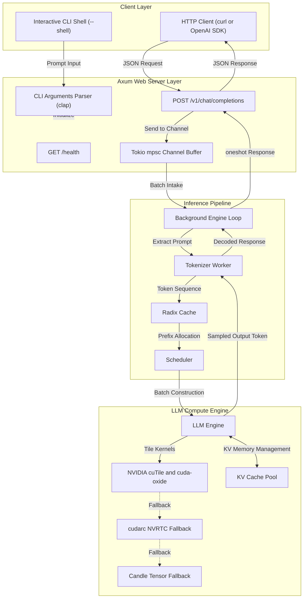
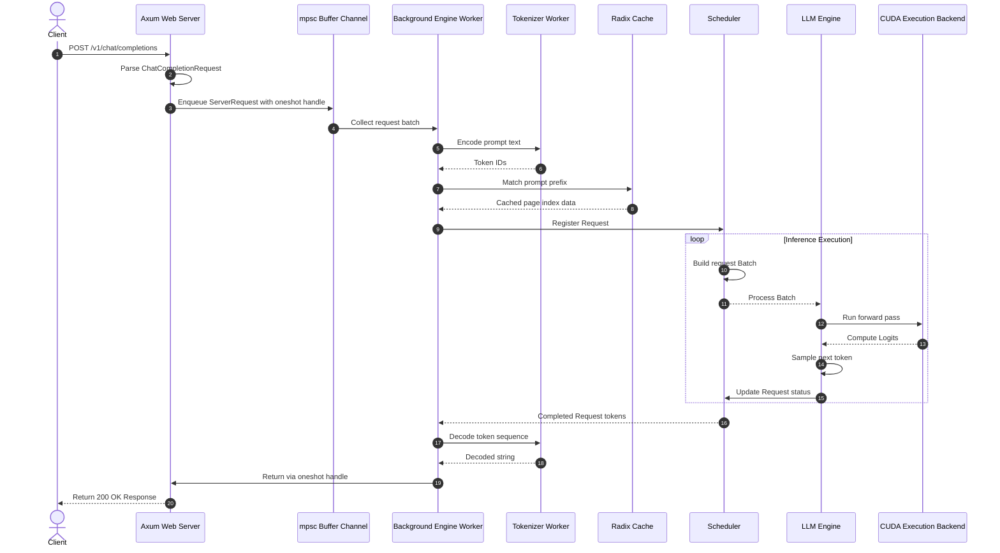
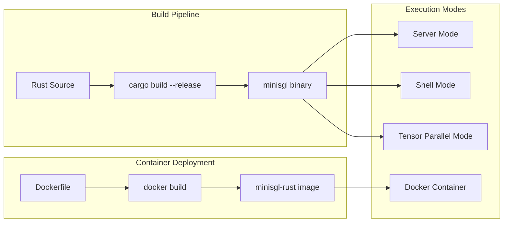
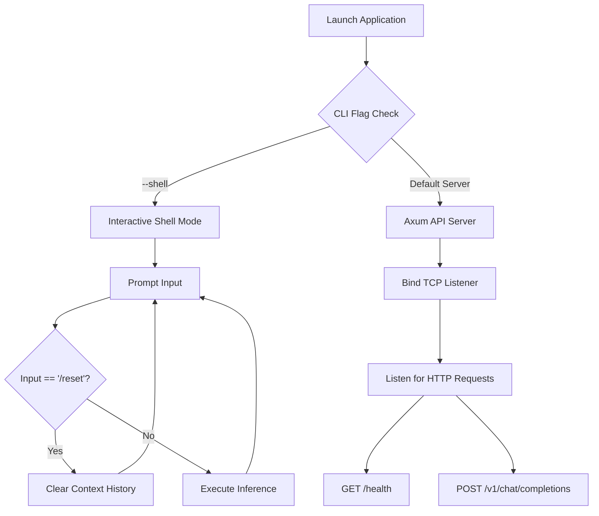

# Mini-SGLang (Pure Rust Edition)

A lightweight inference engine for Large Language Models written in pure Rust.

---

Mini-SGLang is a Rust migration of SGLang. It preserves core features of the original engine while delivering memory management, type safety, and execution through the Tokio async runtime, Axum framework, Candle tensor engine, `cutile` and `cuda-oxide` from NVIDIA CUDA Rust tools, and `cudarc` CUDA operations.

---

## System Architecture



---

## Kernel Execution Hierarchy

Mini-SGLang uses a three-tier kernel execution pipeline for performance across hardware configurations:

1. **Primary Backend (`cuTile` and `cuda-oxide`)**:
   - Built on NVIDIA CUDA Rust tools (`cutile` and `cuda-oxide`).
   - Executes tile-based GPU kernels for index selection, paged KV storage, logit sampling, radix cache operations, RMSNorm, RoPE, and fused MoE.
2. **Secondary Fallback Backend (`cudarc` NVRTC)**:
   - Uses `cudarc` NVRTC runtime compilation for CUDA C++ source kernels when cuTile kernels are inactive.
3. **Tertiary Fallback (`Candle`)**:
   - Executes tensor operations on CPU or GPU via Candle when custom CUDA kernels are disabled.

---

## Request Execution Flow

The sequence diagram below shows the request lifecycle from entry to completion.



### Request Lifecycle Steps

1. **Request Entry**:
   - The client sends an HTTP POST request to `/v1/chat/completions`.
   - Axum converts the JSON payload into a `ChatCompletionRequest` structure.
2. **Async Channel Enqueue**:
   - Axum enqueues the request into an asynchronous `mpsc` channel and awaits response notification via a `oneshot` channel handle.
3. **Dynamic Batching**:
   - The background engine loop collects pending requests from the channel buffer into dynamic execution batches.
4. **Tokenization**:
   - The engine sends prompt text to `TokenizerWorker` to generate numerical token IDs.
5. **Radix Cache Prefix Matching**:
   - `RadixCache` checks existing prefix entries to reuse stored KV cache blocks.
6. **Scheduling**:
   - The engine creates a `Req` structure and queues it. `Scheduler` selects active requests and forms execution batches.
7. **Model Forward Pass**:
   - `LLMEngine` processes the batch using standard neural network layers.
   - GPU operations execute on `cutile`, `cudarc`, or `Candle`.
8. **Token Sampling**:
   - The engine samples the next token according to `SamplingParams`.
   - Generation continues until a stop condition occurs or max token count is reached.
9. **Response Delivery**:
   - `TokenizerWorker` converts generated tokens back into text.
   - The background worker transmits the completed response through the `oneshot` handle to Axum, which delivers a `ChatCompletionResponse` JSON object to the client.

---

## Build and Deployment Flow



### Build Instructions

The engine executes on CPU by default. You can enable CUDA acceleration with Cargo feature flags on supported NVIDIA hardware.

```bash
# Build release binary (CPU mode by default)
cargo build --release

# Build release binary with CUDA acceleration
cargo build --release --features cuda

# Run OpenAI API Server on CPU
cargo run --release -- --model "Qwen/Qwen3-0.6B" --port 8000

# Run OpenAI API Server with CUDA
cargo run --release --features cuda -- --model "Qwen/Qwen3-0.6B" --port 8000

# Run in Interactive Shell Mode
cargo run --release -- --model "Qwen/Qwen3-0.6B" --shell

# Run with Tensor Parallelism
cargo run --release --features cuda -- --model "Qwen/Qwen3-0.6B" --tp 2
```

### Docker Deployment

```bash
# Build Docker image
docker build -t minisgl-rust .

# Run Docker container
docker run -p 8000:8000 minisgl-rust --model Qwen/Qwen3-0.6B
```

---

## Application Workflows



### Command Line Options

| Option | Type | Default | Description |
|---|---|---|---|
| `--model` | String | `"Qwen/Qwen3-0.6B"` | Model ID or file path |
| `--host` | String | `"127.0.0.1"` | Network address for API server |
| `--port` | u16 | `8000` | Port number for API server |
| `--tp` | usize | `1` | Number of GPUs for Tensor Parallelism |
| `--shell` | bool | `false` | Enable interactive shell mode |

---

## Migration Details

Read [MIGRATION.md](MIGRATION.md) for full mapping between Python and Rust components.
