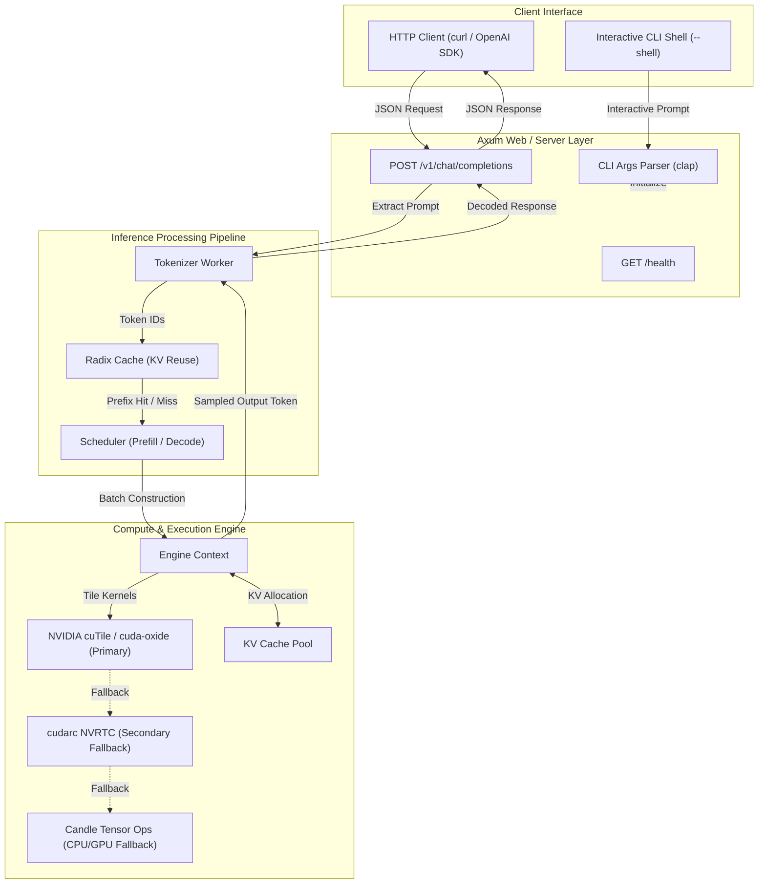
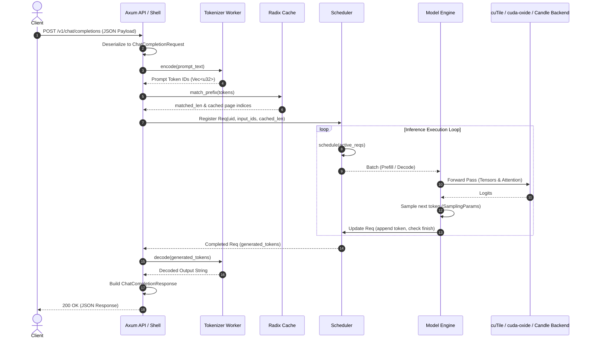
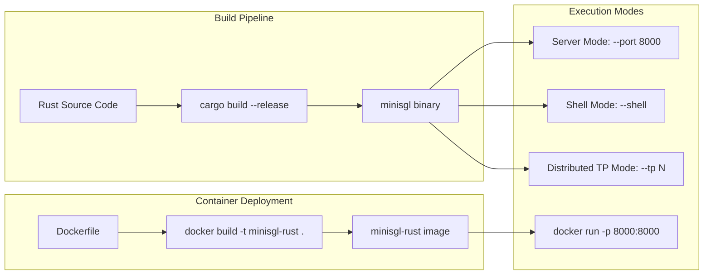
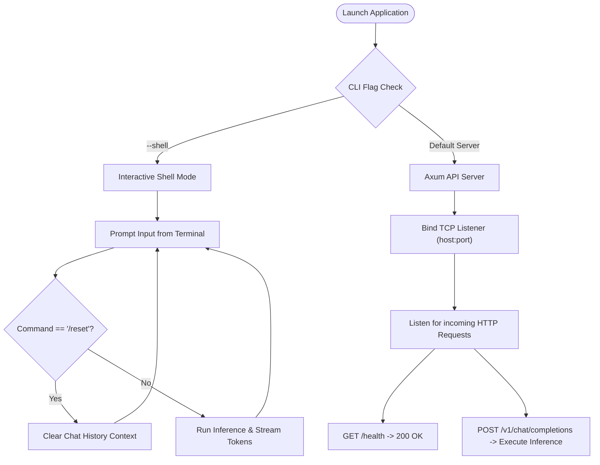

# Mini-SGLang (Pure Rust Edition)

A lightweight, high-performance inference engine for Large Language Models written in pure Rust.

---

Mini-SGLang is a complete, production-grade Rust migration of SGLang. It preserves core features of the original while delivering superior efficiency, type safety, and memory management through Tokio async runtime, Axum web framework, Candle tensor backend, `cutile` and `cuda-oxide` from NVIDIA's `cuda-rust` ecosystem, and `cudarc` CUDA interactions.

---

## High-Level System Architecture



---

## Kernel Execution Architecture & Fallback Hierarchy

Mini-SGLang features a 3-tier kernel execution pipeline designed for performance and adaptability across diverse hardware environments:

1. **Primary Backend (`cuTile` & `cuda-oxide`)**:
   - Built on NVIDIA's official `cuda-rust` ecosystem (`cutile` and `cuda-oxide`).
   - Executes tile-based GPU kernels for index selection, paged KV store, parallel logit sampling, radix cache operations, RMSNorm, RoPE, and fused MoE.
2. **Secondary Fallback Backend (`cudarc` NVRTC)**:
   - Utilizes `cudarc` NVRTC JIT CUDA C++ compilation for custom CUDA kernel execution when cuTile kernels are unsuited or inactive.
3. **Tertiary CPU/GPU Fallback (`Candle`)**:
   - High-compatibility fallback executing tensor operations on Candle (CPU or CUDA).

---

## End-to-End Request Flow

The diagram below traces the end-to-end request lifecycle from request entry to response delivery.



### Detailed Lifecycle Steps

1. **Request Entry & Parsing**:
   - The client sends an HTTP POST request to `/v1/chat/completions` containing the model name, messages, and sampling parameters (`temperature`, `top_p`, `max_tokens`).
   - Axum deserializes the body into a `ChatCompletionRequest` struct.
2. **Tokenization**:
   - The text contents are passed to `TokenizerWorker::encode()` to convert character prompts into numerical token IDs (`Vec<u32>`).
3. **Radix Cache Prefix Matching**:
   - Prompt token IDs are passed to `RadixCache::match_prefix()`.
   - Reusable KV cache tokens and allocated page indices are identified to eliminate redundant prefill computation for shared system prompts or chat history.
4. **Request Registration & Scheduling**:
   - A `Req` instance is constructed with token length metadata, cached length, and sampling configuration.
   - The request is added to the active queue. `Scheduler::schedule()` selects candidate requests and builds a `Batch` for either `Prefill` or `Decode` execution phases.
5. **Model Forward Pass & Kernel Execution**:
   - The engine processes the `Batch` through standard LLM layers (`Linear`, `RMSNorm`, `RotaryEmbedding`).
   - Tile kernels execute via `cutile` & `cuda-oxide`, falling back to `cudarc` or `Candle`.
6. **Sampling & Auto-regressive Generation**:
   - Output logits are processed according to `SamplingParams` (greedy or temperature-based sampling) to pick the next token ID.
   - The token is appended to `Req.generated_tokens`. If the stopping condition or `max_tokens` is reached, the request is marked finished; otherwise, it returns to the decode loop.
7. **Response Formatting**:
   - Final tokens are decoded into string format via `TokenizerWorker::decode()`.
   - The result is packaged into an OpenAI-compatible `ChatCompletionResponse` object and returned as JSON.

---

## Setup & Deployment Flow



### Build & Run Instructions

```bash
# Build release binary (default feature enables cuda, cutile, and cuda-oxide)
cargo build --release

# Run without GPU features on CPU fallback
cargo build --no-default-features

# Run OpenAI API Server (default port 8000)
cargo run --release -- --model "Qwen/Qwen3-0.6B" --port 8000

# Run in Interactive Shell Mode
cargo run --release -- --model "Qwen/Qwen3-0.6B" --shell

# Run with Tensor Parallelism across multiple GPUs
cargo run --release -- --model "Qwen/Qwen3-0.6B" --tp 2
```

### Docker Support

```bash
# Build Docker image
docker build -t minisgl-rust .

# Run Docker container
docker run -p 8000:8000 minisgl-rust --model Qwen/Qwen3-0.6B
```

---

## Usage Workflows



### Command Line Options

| Argument | Type | Default | Description |
|---|---|---|---|
| `--model` | String | `"Qwen/Qwen3-0.6B"` | Model repository ID or path |
| `--host` | String | `"127.0.0.1"` | Bind host for API server |
| `--port` | u16 | `8000` | Bind port for API server |
| `--tp` | usize | `1` | Tensor Parallelism degree (GPU count) |
| `--shell` | bool | `false` | Enable interactive terminal shell mode |

---

## Migration Details

See [MIGRATION.md](MIGRATION.md) for full architectural mappings between Python and Rust components.
