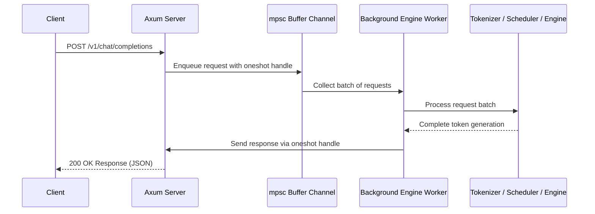
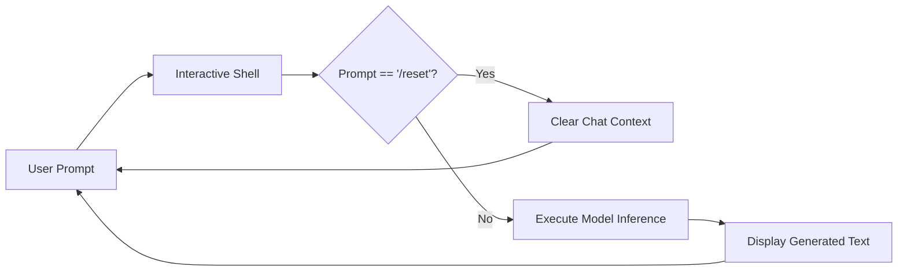
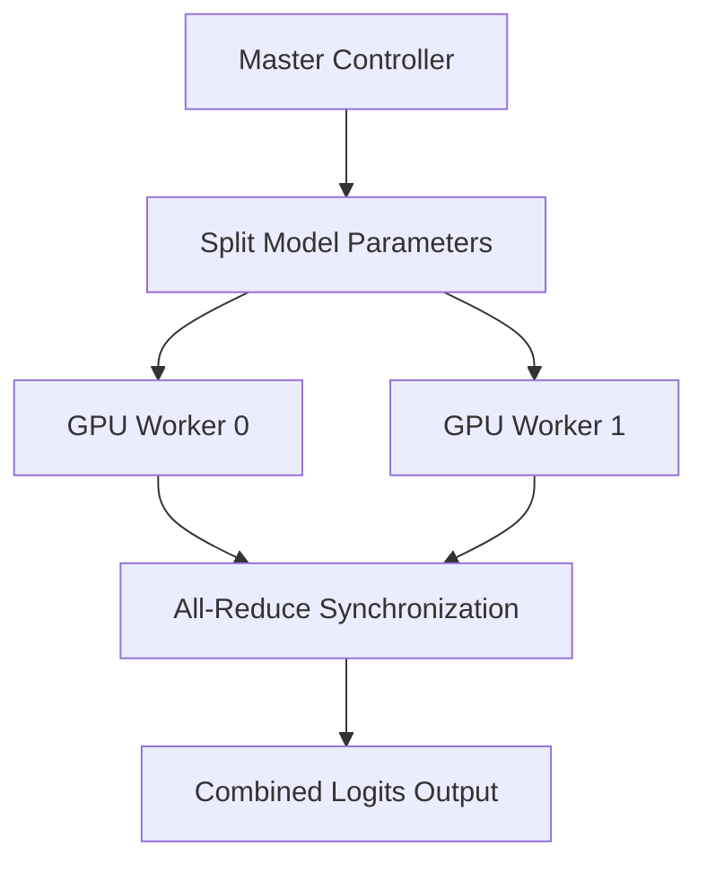
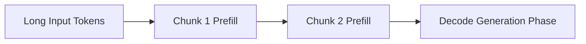
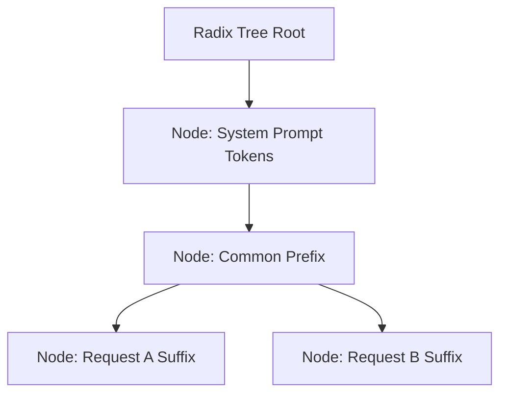

# Features of Mini-SGLang

## Online Serving and Dynamic Request Batching

Mini-SGLang supports online serving with an OpenAI-compatible API server built on the Axum web framework. The server uses an asynchronous `mpsc` buffer channel and background worker loop to collect incoming HTTP requests into dynamic batches before model execution.



To view command-line arguments and configuration parameters, execute:

```bash
cargo run --release -- --help
```

---

## Interactive Shell Mode

An interactive shell mode is available for testing. In this mode, users enter prompts directly into the terminal, and the engine generates responses. The shell caches message history to keep conversation context. To reset context history, enter the `/reset` command.



Example command:

```bash
cargo run --release -- --model "Qwen/Qwen3-0.6B" --shell
```

---

## Distributed Serving

To scale performance across multiple GPU devices, Mini-SGLang supports Tensor Parallelism (TP). Enable distributed serving by setting the GPU count with the `--tp` argument.



---

## Supported Model Architectures

The framework supports the following dense and Mixture-of-Experts (MoE) LLM architectures:

- Llama-3 series
- Qwen-3 series (including MoE)
- Qwen-2.5 series

---

## Chunked Prefill

Chunked Prefill divides long prompts into smaller blocks during prefill phase execution. This technique reduces memory allocation peaks and prevents memory exhaustion on long inputs.



---

## Radix Cache

Mini-SGLang implements a Radix Cache to manage Key-Value (KV) memory in pure Rust. The cache reuses KV entries for shared prompt prefixes across requests, which reduces redundant prefill compute operations.



---

## Overlap Scheduling

Mini-SGLang uses overlap scheduling in the Tokio async runtime to overlap CPU scheduler processing with GPU computation.

```mermaid
gantt
    title Overlap Scheduling Execution Timeline
    dateFormat s
    axisFormat %S
    section GPU Execution
    Prefill Batch 1    :active, gpu1, 0, 2s
    Decode Batch 1     :gpu2, 2s, 4s
    section CPU Execution
    Schedule Batch 2   :cpu1, 1s, 2s
    Schedule Batch 3   :cpu2, 3s, 4s
```
