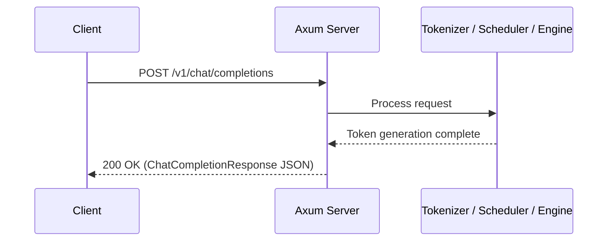
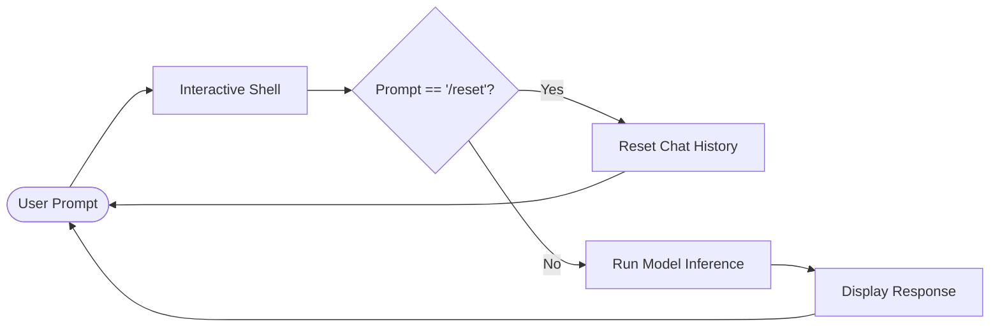
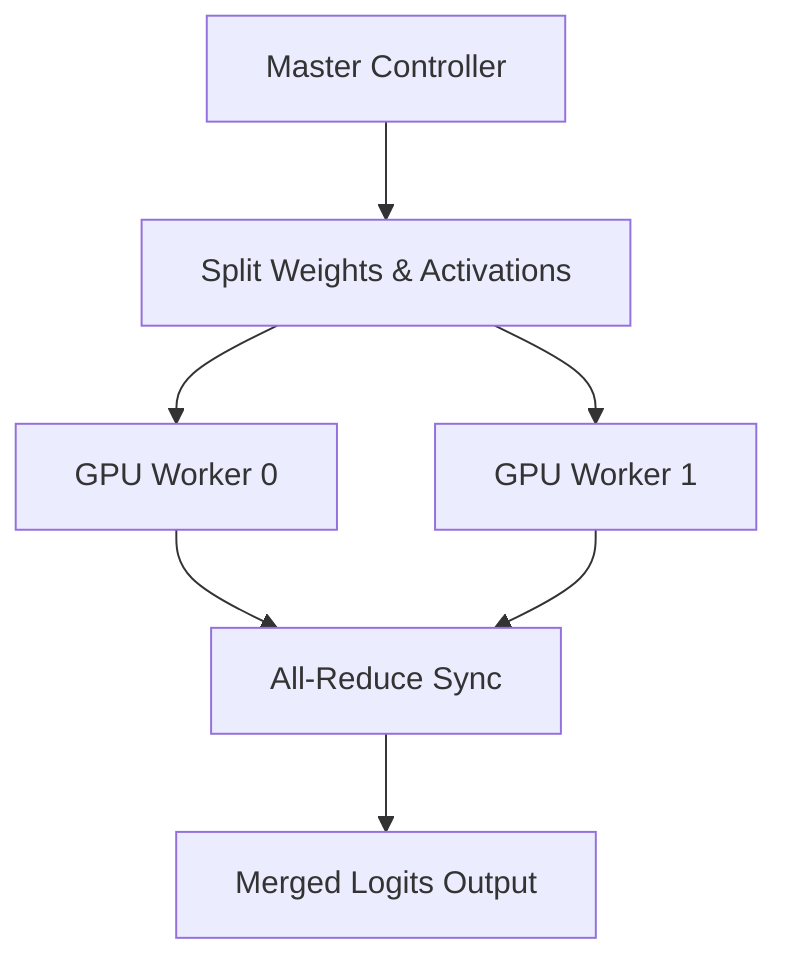
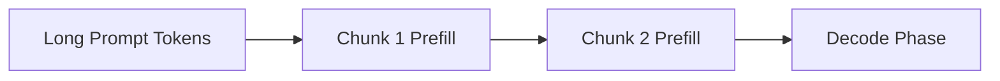
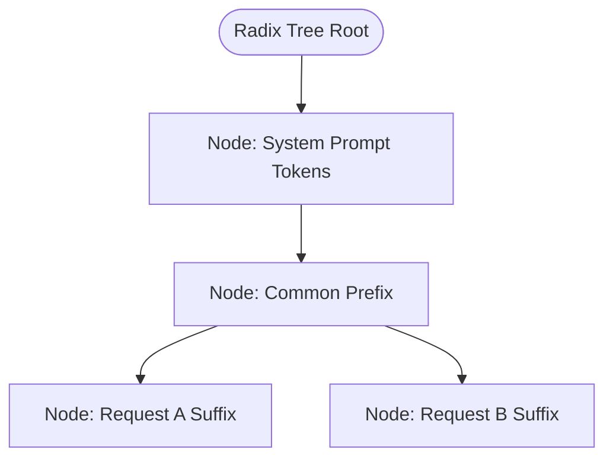

# Features of Mini-SGLang

## Online Serving

Mini-SGLang supports online serving with an OpenAI-compatible API server built on Axum. It provides the standard `/v1/chat/completions` endpoint, allowing seamless integration with existing tools and clients.



For detailed command-line arguments and configuration options, run `cargo run --release -- --help`.

## Interactive Shell Mode

For demonstration and testing purposes, an interactive shell mode is available. In this mode, users can input prompts directly, and the LLM will generate responses in real-time. The shell automatically caches chat history to maintain context. To clear the conversation history and start a new session, use the `/reset` command.



Example:

```bash
cargo run --release -- --model "Qwen/Qwen3-0.6B" --shell
```

## Distributed Serving

To scale performance across multiple GPUs, Mini-SGLang supports Tensor Parallelism (TP). You can enable distributed serving by specifying the number of GPUs with the `--tp n` argument, where `n` is the degree of parallelism.



## Supported Models

Our framework supports the following dense model architectures:

- Llama-3 series
- Qwen-3 series (including MoE)
- Qwen-2.5 series

## Chunked Prefill

Chunked Prefill splits long prompts into smaller chunks during the prefill phase, significantly reducing peak memory usage and preventing Out-Of-Memory (OOM) errors in long-context serving.



## Radix Cache

Adopting the original design from SGLang, Mini-SGLang implements a Radix Cache to manage the Key-Value (KV) cache in pure Rust. This allows the reuse of KV cache for shared prefixes across requests, reducing redundant computation.



## Overlap Scheduling

To further reduce CPU overhead, Mini-SGLang employs overlap scheduling implemented in Tokio async runtime, overlapping CPU scheduling overhead with GPU computation.

```mermaid
gantt
    title Overlap Scheduling Execution Timeline
    dateFormat  s
    axisFormat %S
    section GPU
    Prefill Batch 1    :active, gpu1, 0, 2s
    Decode Batch 1     :gpu2, 2s, 4s
    section CPU
    Schedule Batch 2   :cpu1, 1s, 2s
    Schedule Batch 3   :cpu2, 3s, 4s
```
