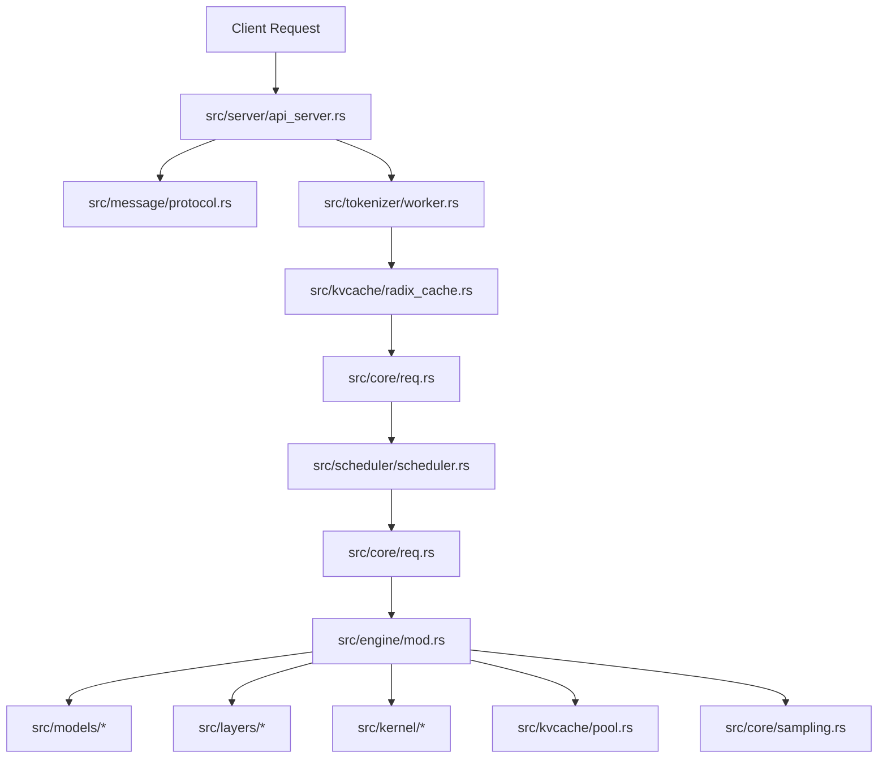

# Structure of Mini-SGLang

## System Architecture

Mini-SGLang is designed as a high-performance system to handle Large Language Model (LLM) inference efficiently in pure Rust.

### Key Components

- **API Server** (`src/server`): Built with Axum. Provides an OpenAI-compatible API (`/v1/chat/completions`) and `/health`. Parses CLI flags via `clap` in `args.rs`.
- **Tokenizer Worker** (`src/tokenizer`): High-throughput HuggingFace tokenization worker for string encoding and token decoding.
- **Radix Cache & KV Pool** (`src/kvcache`): Implements prefix matching and paged KV cache allocation (`RadixCache`, `KVCachePool`).
- **Scheduler Worker** (`src/scheduler`): Manages request queues, builds prefill/decode batches, and overlaps scheduling with computation.
- **Engine & Models** (`src/engine`, `src/models`, `src/layers`): Executes forward passes using Candle tensor operations and cudarc CUDA kernels.

## Code Organization (Rust Workspace)

The source code is located in `src/`. Here is a breakdown of the Rust modules:

- `src/core`: Defines core data structures including `Req`, `Batch`, `BatchPhase`, and `SamplingParams`.
- `src/distributed`: Provides Tensor Parallelism primitives (`tp.rs`) and `DistributedInfo`.
- `src/layers`: Implements standard neural network building blocks (`Linear`, `RMSNorm`, `RotaryEmbedding`).
- `src/models`: Implements LLM model architectures (`llama.rs`, `qwen2.rs`, `qwen3.rs`, MoE variants).
- `src/kvcache`: Implements `RadixCache` for prefix reuse and `KVCachePool` for paged KV memory allocation.
- `src/utils`: Logging and environment configurations.
- `src/engine`: Engine initialization and Candle tensor execution context.
- `src/message`: Axum protocol types for OpenAI API compatibility (`ChatCompletionRequest`, `ChatCompletionResponse`).
- `src/scheduler`: Implements `Scheduler` with overlap prefill/decode logic.
- `src/server`: Axum API server (`api_server.rs`), CLI launcher (`launch.rs`), and CLI argument parsing (`args.rs`).
- `src/tokenizer`: HuggingFace tokenizer wrapper worker.
- `src/kernel`: CUDA NVRTC kernel bindings and Candle fallback operations.
