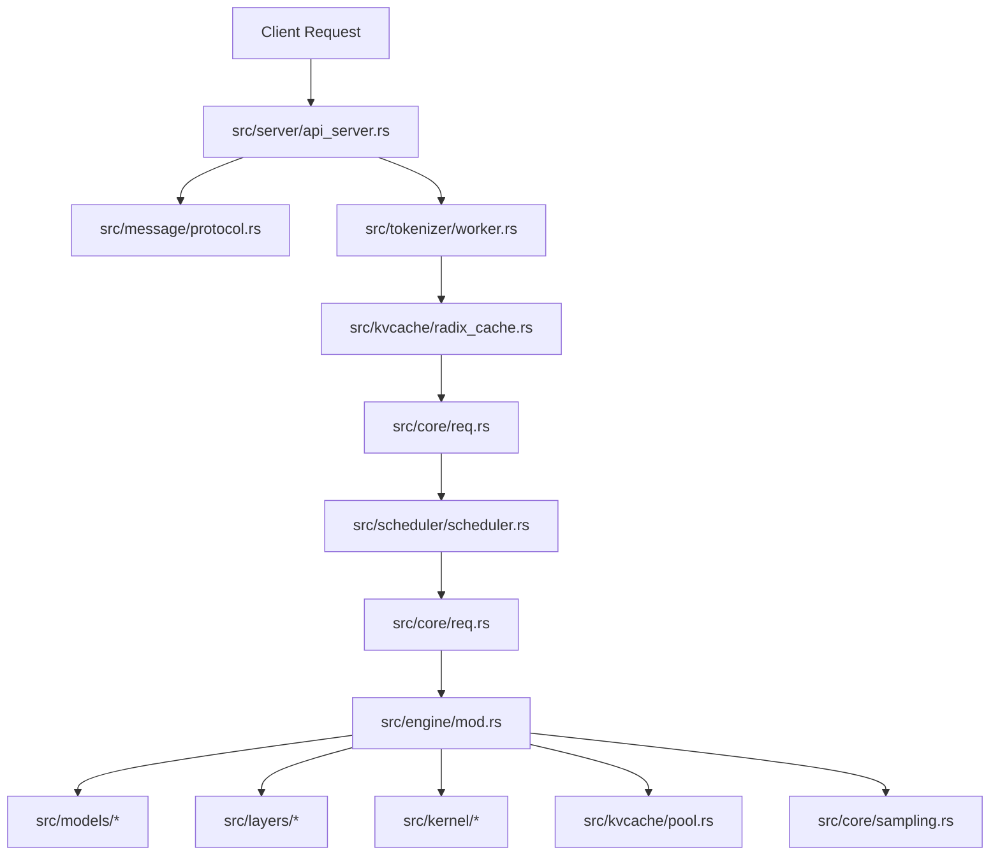

# Structure of Mini-SGLang

## System Architecture

Mini-SGLang is designed as a system to execute Large Language Model (LLM) inference in pure Rust.

---

## Core Modules

- **API Server (`src/server`)**: Axum web application that handles `/v1/chat/completions` and `/health` HTTP endpoints. Parses command-line flags with `clap` in `args.rs`.
- **Tokenizer Worker (`src/tokenizer`)**: Converts prompt text into token IDs and decodes generated token sequences into text.
- **Radix Cache and KV Pool (`src/kvcache`)**: Manages prefix key-value reuse and paged KV memory allocation via `RadixCache` and `KVCachePool`.
- **Scheduler (`src/scheduler`)**: Manages pending requests, builds prefill and decode execution batches, and schedules iteration steps.
- **Engine, Models, and Layers (`src/engine`, `src/models`, `src/layers`)**: Runs neural network operations and kernel calls using Candle tensors and NVIDIA CUDA execution backends.

---

## Code Directory Layout

Source code files exist in `src/`:

- `src/core`: Data structures: `Req`, `Batch`, `BatchPhase`, and `SamplingParams`.
- `src/distributed`: Tensor Parallelism primitives (`tp.rs`) and `DistributedInfo`.
- `src/layers`: Layer abstractions (`Linear`, `RMSNorm`, `RotaryEmbedding`).
- `src/models`: Model implementations (`llama.rs`, `qwen2.rs`, `qwen3.rs`, and MoE variants).
- `src/kvcache`: `RadixCache` for prefix lookup and `KVCachePool` for paged memory allocation.
- `src/engine`: Execution context for model processing.
- `src/message`: Data types for OpenAI API compatibility (`ChatCompletionRequest`, `ChatCompletionResponse`).
- `src/scheduler`: `Scheduler` implementation with batch construction logic.
- `src/server`: Web server implementation (`api_server.rs`), CLI runner (`launch.rs`), and flag parser (`args.rs`).
- `src/tokenizer`: Tokenizer processing worker.
- `src/kernel`: CUDA kernel bindings (`cutile`, `cuda-oxide`, `cudarc`) and Candle fallback logic.
